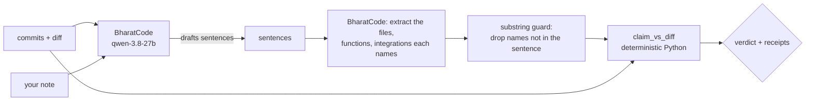

# Shakira | Commits Don't Lie

*Shakira knows hips don't lie. We checked — neither do commits.*

[](https://youtu.be/zolODgOZ-uM)

**▶ [Watch the 2-minute demo](https://youtu.be/zolODgOZ-uM)**: a real note over-claims, the gate
blocks that sentence, the fixed draft lands in Slack with receipts, approval re-checks the code,
and a published post turns *Stale* with a threaded correction after the function it cited is
renamed. GitHub, Notion and Slack, end to end.

> Every build-in-public tool drafts a post that sounds like you. None of them check whether
> it's true. Shakira does, and it keeps checking after you hit send.

Model calls run on **[BharatCode](https://bharatcode.ai/build)** (`qwen-3.8-27b`) ·
BharatCode Build League, Round 1 · [`BharatCode.txt`](BharatCode.txt) ·
**Live dashboard:** https://commitsdontlie.akashparashar.dev

---

## What it does

You push code and write a note about what you did. Shakira drafts the build-in-public post in
your voice, then checks **every sentence against the actual diff**:

> Every file, function, or integration a sentence names must appear in the diff, or the
> sentence doesn't ship.

| Verdict | Meaning |
|---|---|
| ✅ SUPPORTED | every named thing was found in the diff; `file:line` receipts attached |
| ⛔ UNSUPPORTED | a named thing is missing from the diff → sentence blocked, reason shown |
| ❔ UNVERIFIABLE | names nothing checkable (pure voice) → allowed, max one per post, labelled |

Approved posts go to Slack for one-tap approval and a hand-off to X. After that, **every
future push re-checks every published post**. If the code a post cited is removed or renamed,
the post is flagged *Stale* and a correction is threaded under the original message.

## Try it in 60 seconds

No GitHub app, no Notion, no Slack. You need Python 3.12+, a git repo, and a BharatCode API key
from [bharatcode.ai/account](https://bharatcode.ai/account) (free for students).

```bash
pip install git+https://github.com/adot-7/commits-dont-lie
export BHARATCODE_API_KEY=bc_live_...

cd your-project
shakira check -n 3 "Your post about the last three commits goes here."
shakira draft -n 5 --note "what you think you shipped this week"
```

A real run on this repository's commit `d1cade1`, unedited:

```text
$ shakira check -r d1cade1~1..d1cade1 "compare() now matches its own definition in cdl/grounding/check.py, with a regression test in tests/test_check.py. Also added response caching to cdl/slack_client.py. That one regex cost me two eval runs."
adot-7/commits-dont-lie 52dd0a8..d1cade1 · 1 commit · 2 files

✅ "compare() now matches its own definition in cdl/grounding/check.py, with a regression test in tests/test_check.py." → cdl/grounding/check.py (cdl/grounding/check.py), tests/test_check.py (tests/test_check.py), cdl/grounding/check.py:78 (compare()), tests/test_check.py:263 (compare())
⛔ "Also added response caching to cdl/slack_client.py." → missing: cdl/slack_client.py
❔ "That one regex cost me two eval runs." → no checkable claim

BLOCKED — 1 sentence(s) would not ship:
  • Also added response caching to cdl/slack_client.py. ('cdl/slack_client.py' does not appear in the 2 files changed in 52dd0a8..d1cade1.)

What the diff does support:
  compare() now matches its own definition in cdl/grounding/check.py, with a regression test in tests/test_check.py. That one regex cost me two eval runs.
```

`shakira check` exits **1** when any sentence would not ship, so it works as a pre-push hook or
a CI step. `shakira draft` writes the post from your commits first, then runs the same check.
Add `--json` for a machine-readable report.

## How it decides



- **The model never decides a verdict.** It does two jobs: draft sentences, and extract the
  names each sentence mentions, both through forced function calls with a JSON schema. A plain
  Python function, [`cdl/grounding/check.py::claim_vs_diff`](cdl/grounding/check.py), matches
  those names against the diff and attaches receipts. Same input, same verdict, every time.
- **The model can't smuggle names in.** Any extracted name that is not literally in the
  sentence is dropped before matching, so a name that happens to be in the diff can't rescue a
  vague sentence.
- **Edited bodies count.** "Fixed `_symbol_pattern`" is backed when a changed line sits inside
  `def _symbol_pattern`, even if the `def` line itself didn't change.
- **One function, two call sites.** The same matcher runs before publishing and, inverted,
  after it: did this new push *remove* a receipt an already-published post depends on?

## How it uses BharatCode

| | |
|---|---|
| Endpoint | `POST https://bharatcode.ai/api/model/v1/chat/completions` (OpenAI-compatible), raw HTTPS via `httpx` |
| Model | `qwen-3.8-27b` (set `BHARATCODE_MODEL` to change) |
| Calls | one forced function tool per call: `draft_sentences` and `extract_entities` |
| Output budget | `finish_reason: length` is never used as a partial answer: retry once with double the budget, then fail loudly |
| Errors | 429 / 503 retried with backoff; auth and budget failures are not resent; the CLI exits 2 |
| Audit | every call logs tokens, latency and BharatCode's `x-request-id` |
| Code | [`cdl/bharatcode_client.py`](cdl/bharatcode_client.py), [`cdl/llm.py`](cdl/llm.py) |

Measured on this repo (26 Oct 2026): one extraction is about 600 input tokens and 2–3 seconds;
a full `shakira draft` of five sentences took 31 seconds. Anthropic Claude also works, with
`LLM_PROVIDER=anthropic`.

## How we know it works

**Evaluation on BharatCode `qwen-3.8-27b`: 28/30 claims (93.3%), 5/5 staleness cases**
([`eval/report.md`](eval/report.md), 26 Oct 2026). `make eval` runs the full production path
(BharatCode extraction → substring guard → `claim_vs_diff`) on
[30 hand-labelled sentences](eval/cases.jsonl) written against 8 real commits of this repo: per
commit one true claim, one plausible false claim naming code the commit did not touch, one
pure-voice sentence, plus 6 adversarial cases (real file in the wrong range, near-miss
filename, multi-word integration, two entities with one missing, decoy integration, pure
voice).

| expected \ got | SUPPORTED | UNSUPPORTED | UNVERIFIABLE |
|---|---|---|---|
| SUPPORTED | 9 | 0 | 0 |
| UNSUPPORTED | 1 | 11 | 0 |
| UNVERIFIABLE | 1 | 0 | 8 |

The two misses, stated plainly: a voice sentence that says "notion api" was matched to the
commit's Notion changes (arguably correct), and a decoy "Anthropic client" claim matched a
placeholder string in a test file, because integration names alone are weak receipts. Two
earlier runs scored 27/30 with identical misses; the third miss was a matcher bug (`compare()`
written with parentheses) that is now fixed and tested.

- **Offline tests:** `make test`. They cover the diff parser, every verdict rule, every
  staleness rule (removed file, renamed file, net-removed symbol; a *moved* symbol and a body
  edit are not stale), the substring guard, forced tool calls for both providers, BharatCode's
  length / busy / auth handling, local git diffs (merge-base ranges, merges, renames, glob-like
  file names), the publish gate, approval mid-check, corrections, the dashboard and the eval
  harness.
- **Local diffs match GitHub's.** The CLI reads diffs from your local repo; checked against the
  live GitHub compare API on `40cd3db...4fb4a7b`: 22 commits, 35 files, identical statuses and
  line numbers.
- **Live event log:** every external call and every verdict is an append-only event in SQLite.
  Nothing fails silently: a failed external write marks the post `Errored` with the reason.
- **Dogfooding:** Shakira checks its own repository. The posts on the live dashboard are real,
  and the blocked sentences were real over-claims.

**What it does not do.** The check is lexical, not semantic: a sentence can name the right file
and still mischaracterise what changed inside it. Integration names alone are weak receipts.
Drift is tracked for the repository's own code only. The service is single repo, single
channel, single operator.

## Use it as a gate

Pre-push hook (`.git/hooks/pre-push`, make it executable):

```bash
#!/usr/bin/env bash
# Block the push if the draft post in POST.md claims something the unpushed commits don't do.
[ -f POST.md ] || exit 0
shakira check -r origin/main..HEAD -f POST.md
```

CI: `shakira check -r "$BASE..$HEAD" -f RELEASE_NOTES.md --json` fails the job on any
unsupported sentence. Exit codes: 0 pass, 1 blocked, 2 error.

## The full service: GitHub → Notion → Slack → X

This is what the demo video shows: a web service that runs on every push.

| App | Role |
|---|---|
| **GitHub** | Push webhook (HMAC-verified) triggers every run; the compare API supplies the diff with line numbers. |
| **Notion** | Your dev notes (what you *meant*) are read from a Notes database; every post is mirrored to a Posts database with status, receipts and corrections. |
| **Slack** | Drafts arrive with receipts and Approve/Reject buttons; approval re-checks against HEAD; corrections are threaded under the original message. |
| **BharatCode** | Drafting and entity extraction only. |
| **X** | After approval, a "Post on X" button opens the compose box prefilled; a human presses Post. |

<details>
<summary><b>Service setup</b> (GitHub webhook, Notion databases, Slack app, VM)</summary>

Runs as one Python 3.12 process (FastAPI) behind Caddy on a 1 GB VM. No Docker, no queue.

```bash
git clone https://github.com/adot-7/commits-dont-lie.git && cd commits-dont-lie
python3 -m venv .venv && .venv/bin/pip install -r requirements.txt
cp .env.example .env            # fill every value; no inline comments (systemd EnvironmentFile)
```

1. **BharatCode**: `BHARATCODE_API_KEY` from https://bharatcode.ai/account;
   `python -m cdl models` lists the model IDs your key can use.
2. **GitHub**: fine-grained PAT (Contents + Metadata, read-only) → `GITHUB_TOKEN`. Generate
   `GITHUB_WEBHOOK_SECRET` (`openssl rand -hex 32`). After deploy: repo → Settings → Webhooks →
   payload URL `https://<host>/webhook/github`, JSON, that secret, push events only.
3. **Notion**: internal integration → `NOTION_TOKEN`. Create two databases under one page and
   connect the integration to the page:
   - `Notes`: `Name` (title), `Status` (select: Writing / Ready / Drafted), `Created` (created time)
   - `Posts`: `Name`, `Status` (select: Blocked / Draft / Sent / Rejected / Stale / Correction / Errored),
     `Post Text`, `Evidence`, `Commit Range`, `Head SHA`, `Slack TS` (text), `Superseded By`
     (relation → Posts), `Note` (relation → Notes), `Dashboard` (URL)
   - Put the two database IDs in `.env`, then `python -m cdl resolve-notion-ids` → paste the two
     data-source IDs. The app asserts this schema at boot and names anything missing.
4. **Slack**: app with scopes `chat:write`, `chat:write.public` → `SLACK_BOT_TOKEN`; Basic
   Information → Signing Secret → `SLACK_SIGNING_SECRET`; invite the bot to a channel →
   `SLACK_CHANNEL_ID`. Interactivity **on**, Socket Mode **off**, Request URL
   `https://<host>/slack/interactions`.
5. `ADMIN_TOKEN` (`openssl rand -hex 16`) protects `POST /draft-now`. `FIRST_SHA` sets the base
   of the first post's range. Optional `style/examples.md` holds past posts for voice.

**Run:** `python -m cdl serve` (validates config, asserts Notion schema, then serves on
127.0.0.1:8000). Production files: `deploy/cdl.service`, `deploy/Caddyfile`, `deploy/deploy.sh`;
full VM runbook in [`docs/07-DEPLOY.md`](docs/07-DEPLOY.md).

**Use:** write a note in Notion → set `Ready` → push (or `POST /draft-now`). Blocked posts say
why and leave the note `Ready`; passing drafts arrive in Slack with receipts. Approve → Sent →
"Post on X". Every later push re-checks every Sent post.
</details>

Architecture, data contracts and integration call sheets are in [`docs/`](docs/).

---

If Shakira ever stops you from posting something your code doesn't do, a ⭐ helps other people
find it.

MIT.
