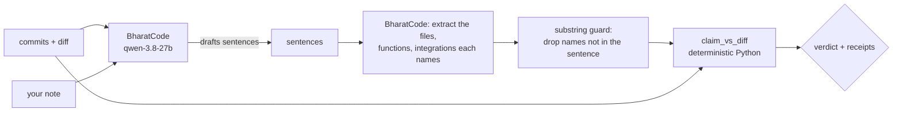

# Commits Don't Lie

*Shakira knows hips don't lie. We checked — neither do commits.*

> Every build-in-public tool drafts a post that sounds like you. None of them check whether
> it's true. This one does, and it keeps checking after you hit send.

**Model calls run on [BharatCode](https://bharatcode.ai/build)** (`qwen-3.8-27b`). Entered in
BharatCode Build League, Round 1 · direction: *Coding & developer tools* · [`BharatCode.txt`](BharatCode.txt)

<!-- TODO(live): replace this illustration with an excerpt of a real run before merging. -->
```
You wrote:   "Added rate limiting to the webhook and cleaned up the Slack client."
Your diff:   touched cdl/app.py and cdl/slack_client.py. No rate limiter anywhere.
CDL:         ⛔ blocked: the post claims something your commits never did.
```

---

## Try it in 60 seconds

You need Python 3.12+, a git repo, and a BharatCode API key from
[bharatcode.ai/account](https://bharatcode.ai/account). Students with a `.edu.in` / `.ac.in`
email get free access.

```bash
pip install git+https://github.com/adot-7/commits-dont-lie
export BHARATCODE_API_KEY=bc_live_...

cd your-project
cdl check -n 3 "Your post about the last three commits goes here."
cdl draft -n 5 --note "what you think you shipped this week"
```

`cdl check` marks every sentence ✅ supported (with file:line receipts), ⛔ unsupported (with
the name it could not find), or ❔ unverifiable (pure voice, at most one per post). It exits
**1** if any sentence would not ship, so it works as a pre-push hook or a CI step.
`cdl draft` writes the post from your commits first, then runs the same check on it.

<!-- TODO(live): paste a real `cdl check` run on this repo here, unedited, before merging to main. -->

## Why

People who build in public write "here's what I shipped" posts from memory and intent. Tools
that automate this draft from commits and optimise for *voice*; none of them check whether
the draft is *true*. A note that says "wired the dashboard tonight" becomes a post even when
the dashboard commit never landed. And once a post is out, nobody re-checks it when the code
it described is deleted next week.

## How it decides

> Every file, function, or integration a sentence names must appear in the diff, or the
> sentence doesn't ship.



- **The model never decides a verdict.** It does two jobs: draft sentences, and extract the
  names each sentence mentions, both through forced function calls with a JSON schema. A plain
  Python function, [`cdl/grounding/check.py::claim_vs_diff`](cdl/grounding/check.py), matches
  those names against the diff and attaches `file:line` receipts. Same input, same verdict,
  every time.
- **The model can't smuggle names in.** Any extracted name that is not literally in the
  sentence is dropped before matching, so a name that happens to be in the diff can't rescue a
  vague sentence.
- **One function, two call sites.** The same matcher runs before publishing and, inverted,
  after it: on every later push, the server re-checks every published post and flags it
  *Stale* if the code it cited was removed or renamed.

| Verdict | Meaning |
|---|---|
| ✅ SUPPORTED | every named thing was found in the diff; receipts attached |
| ⛔ UNSUPPORTED | a named thing is missing from the diff → sentence blocked, reason shown |
| ❔ UNVERIFIABLE | names nothing checkable (pure voice) → allowed, max one per post, labelled |

## How it uses BharatCode

| | |
|---|---|
| Endpoint | `POST https://bharatcode.ai/api/model/v1/chat/completions` (OpenAI-compatible), raw HTTPS via `httpx` |
| Model | `qwen-3.8-27b` (set `BHARATCODE_MODEL` to change) |
| Calls | one forced function tool per call: `draft_sentences` and `extract_entities` |
| Output budget | `finish_reason: length` is never used as a partial answer: retry once with double the budget, then fail loudly |
| Busy model | 429 / 503 retried with backoff |
| Audit | every call logs tokens, latency and BharatCode's `x-request-id` to the event log |
| Code | [`cdl/bharatcode_client.py`](cdl/bharatcode_client.py), [`cdl/llm.py`](cdl/llm.py) |

Anthropic Claude is still supported with `LLM_PROVIDER=anthropic`; that is what the September
version used.

## Use it as a gate

Pre-push hook (`.git/hooks/pre-push`, make it executable):

```bash
#!/usr/bin/env bash
# Block the push if the draft post in POST.md claims something the unpushed commits don't do.
[ -f POST.md ] || exit 0
cdl check -r origin/main..HEAD -f POST.md
```

CI: `cdl check -r "$BASE..$HEAD" -f RELEASE_NOTES.md --json` prints a machine-readable report
and fails the job on any unsupported sentence.

## The full service: GitHub → Notion → Slack → X

The CLI is the quickest way in. The original product is a web service that runs on every push:

| App | Role |
|---|---|
| **GitHub** | Push webhook (HMAC-verified) triggers every run; the compare API supplies the diff with line numbers. |
| **Notion** | Your dev notes (what you *meant*) are read from a Notes database; every post is mirrored to a Posts database with status, receipts and corrections. |
| **Slack** | Drafts arrive with receipts and Approve/Reject buttons; approval re-checks against HEAD; corrections are threaded under the original message. |
| **BharatCode** | Drafting and entity extraction only. |
| **X** | After approval, a "Post on X" button opens the compose box prefilled; a human presses Post. |

**▶ Demo (2 min, September version on Claude):** https://youtu.be/zolODgOZ-uM ·
**Live dashboard:** https://commitsdontlie.akashparashar.dev

The video shows a real note over-claiming, the gate blocking that sentence, the fixed draft
passing with receipts, approval re-checking HEAD, and a published post going *Stale* with a
threaded correction after the function it cited was renamed.

<details>
<summary><b>Service setup</b> (GitHub webhook, Notion databases, Slack app, VM)</summary>

Runs as one Python 3.12 process (FastAPI) behind Caddy on a 1 GB VM. No Docker, no queue.

```bash
git clone https://github.com/adot-7/commits-dont-lie.git && cd commits-dont-lie
python3 -m venv .venv && .venv/bin/pip install -r requirements.txt
cp .env.example .env            # fill every value; no inline comments (systemd EnvironmentFile)
```

1. **BharatCode**: `BHARATCODE_API_KEY` from https://bharatcode.ai/account;
   `python -m cdl models` lists the model IDs your key can use.
2. **GitHub**: fine-grained PAT (Contents + Metadata, read-only) → `GITHUB_TOKEN`. Generate
   `GITHUB_WEBHOOK_SECRET` (`openssl rand -hex 32`). After deploy: repo → Settings → Webhooks →
   payload URL `https://<host>/webhook/github`, JSON, that secret, push events only.
3. **Notion**: internal integration → `NOTION_TOKEN`. Create two databases under one page and
   connect the integration to the page:
   - `Notes`: `Name` (title), `Status` (select: Writing / Ready / Drafted), `Created` (created time)
   - `Posts`: `Name`, `Status` (select: Blocked / Draft / Sent / Rejected / Stale / Correction / Errored),
     `Post Text`, `Evidence`, `Commit Range`, `Head SHA`, `Slack TS` (text), `Superseded By`
     (relation → Posts), `Note` (relation → Notes), `Dashboard` (URL)
   - Put the two database IDs in `.env`, then `python -m cdl resolve-notion-ids` → paste the two
     data-source IDs. The app asserts this schema at boot and names anything missing.
4. **Slack**: app with scopes `chat:write`, `chat:write.public` → `SLACK_BOT_TOKEN`; Basic
   Information → Signing Secret → `SLACK_SIGNING_SECRET`; invite the bot to a channel →
   `SLACK_CHANNEL_ID`. Interactivity **on**, Socket Mode **off**, Request URL
   `https://<host>/slack/interactions`.
5. `ADMIN_TOKEN` (`openssl rand -hex 16`) protects `POST /draft-now`. `FIRST_SHA` sets the base
   of the first post's range. Optional `style/examples.md` holds past posts for voice.

**Run:** `python -m cdl serve` (validates config, asserts Notion schema, then serves on
127.0.0.1:8000). Production files: `deploy/cdl.service`, `deploy/Caddyfile`, `deploy/deploy.sh`;
full VM runbook in [`docs/07-DEPLOY.md`](docs/07-DEPLOY.md).

**Use:** write a note in Notion → set `Ready` → push (or `POST /draft-now`). Blocked posts say
why and leave the note `Ready`; passing drafts arrive in Slack with receipts. Approve → Sent →
"Post on X". Every later push re-checks every Sent post.
</details>

## How we know it works

<!-- TODO(live): eval numbers from `make eval` on BharatCode, with date, before merging to main. -->

- **Offline tests:** `make test`. They cover the diff parser (hunk-header line numbers), every
  verdict rule (file / symbol / integration matching, alias expansion, evidence ranking and
  cap, the UNVERIFIABLE boundary), every staleness rule (removed file, renamed file, net-removed
  symbol; a *moved* symbol and a body edit are not stale), the substring guard, forced tool-call
  validation for both providers, BharatCode's length / busy / auth handling, local git diffs
  (renames, empty-tree ranges), the publish gate, approval mid-check, corrections, the dashboard
  and the eval harness.
- **Local diffs match GitHub's.** `cdl/local_git.py` was checked against the live GitHub
  compare API on `40cd3db...4fb4a7b`: 22 commits, 35 files, identical statuses and added/removed
  line numbers.
- **Hand-labelled evaluation set:** [`eval/cases.jsonl`](eval/cases.jsonl). 30 sentences
  written against 8 real commits of this repo: per commit one true claim, one plausible false
  claim naming code the commit did not touch, one pure-voice sentence, plus 6 adversarial cases
  (real file in the wrong range, near-miss filename, multi-word integration, two entities with
  one missing, decoy integration, pure voice). `make eval` runs the full production path
  (BharatCode extraction → guard → match) on local diffs and writes a confusion matrix to
  `eval/report.md`.
- **Live event log:** every external call and every verdict is an append-only event in SQLite
  and a JSON line on stdout. Nothing fails silently: a failed external write marks the post
  `Errored` with the component and reason.
- **Dogfooding:** the tool was pointed at its own repository while it was being built. The
  posts on the live dashboard are real, and the blocked sentences were real over-claims.

**What it does not do.** The check is lexical, not semantic: a sentence can name the right file
and still mischaracterise what changed inside it. Integration names alone are weak receipts.
Drift is tracked for the repository's own code only. The service is single repo, single
channel, single operator.

## History

Built solo in one night at the Multi-App AI Agent Hackathon (Lemma × Comma Capital,
13 Sep 2026); that version is preserved on the
[`lemma-hackathon`](https://github.com/adot-7/commits-dont-lie/tree/lemma-hackathon) branch.
For BharatCode Build League it gained the BharatCode provider, the zero-setup CLI and local
diffs, and a published eval run; details in [`docs/WHAT_CHANGED.md`](docs/WHAT_CHANGED.md).
Architecture, data contracts and integration call sheets are in [`docs/`](docs/).

If CDL ever stops you from posting something your code doesn't do, a ⭐ helps other people
find it.

MIT.
